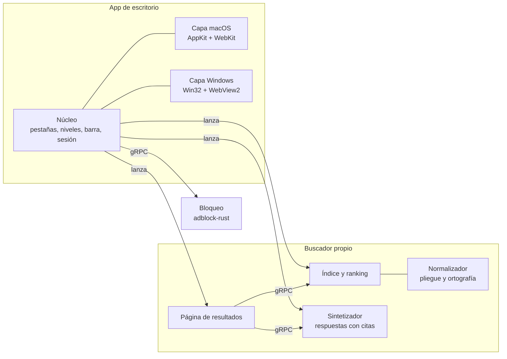
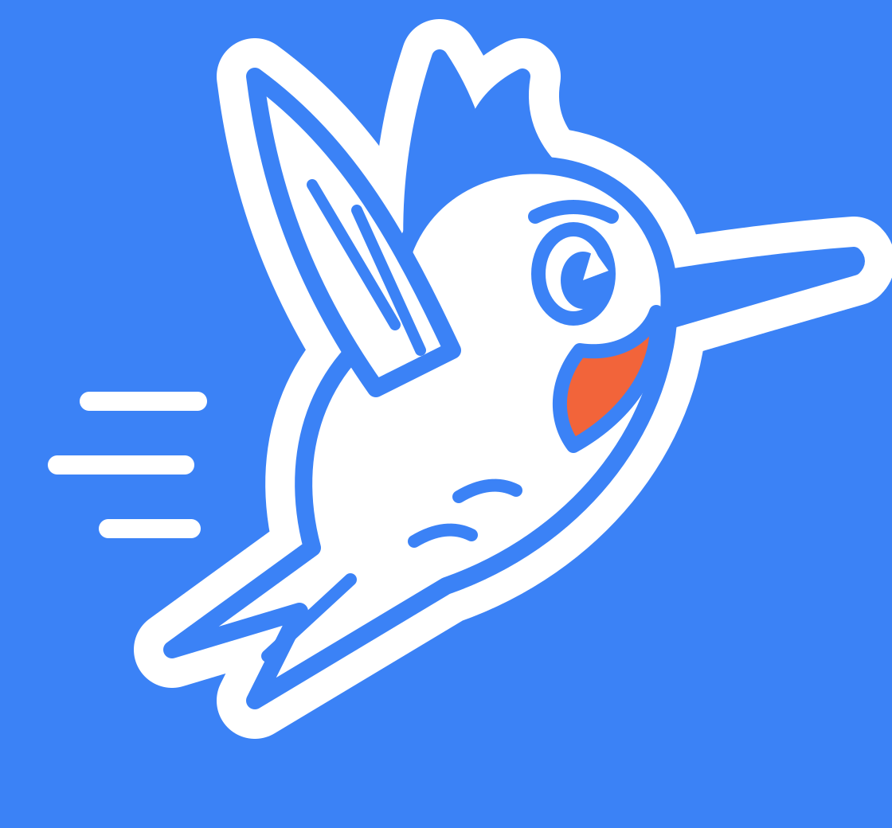
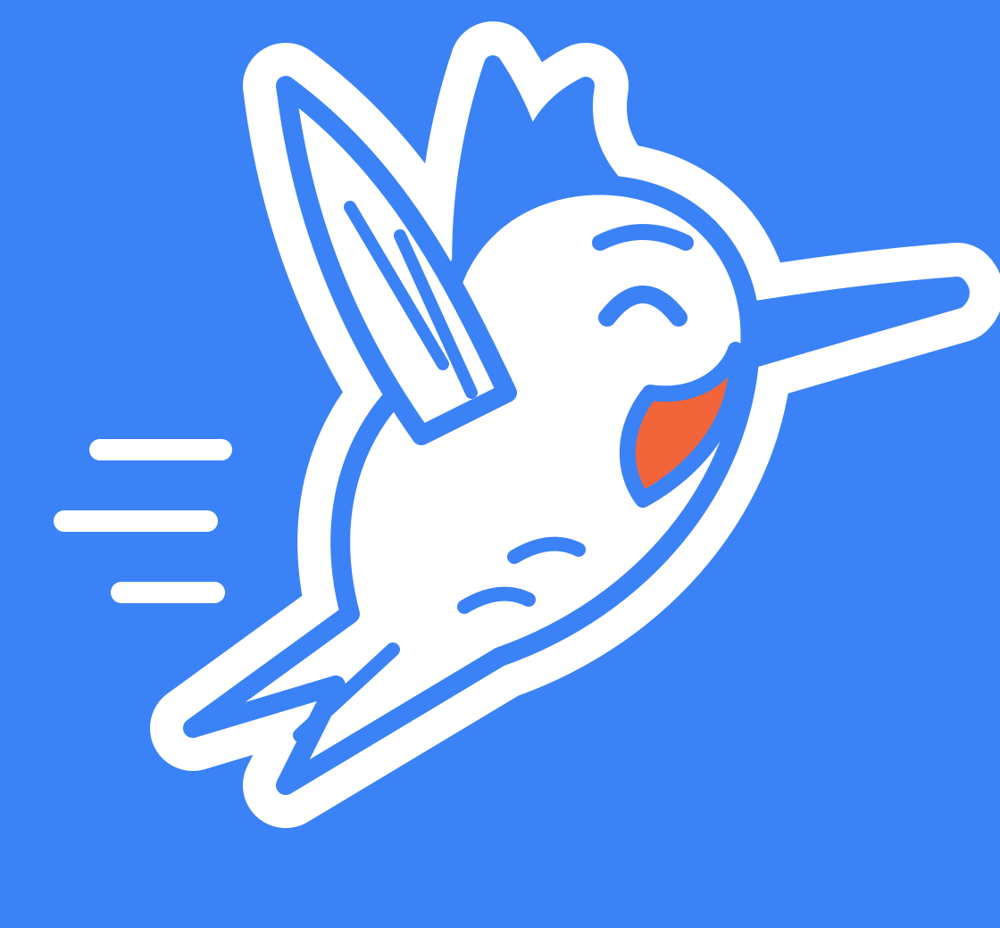
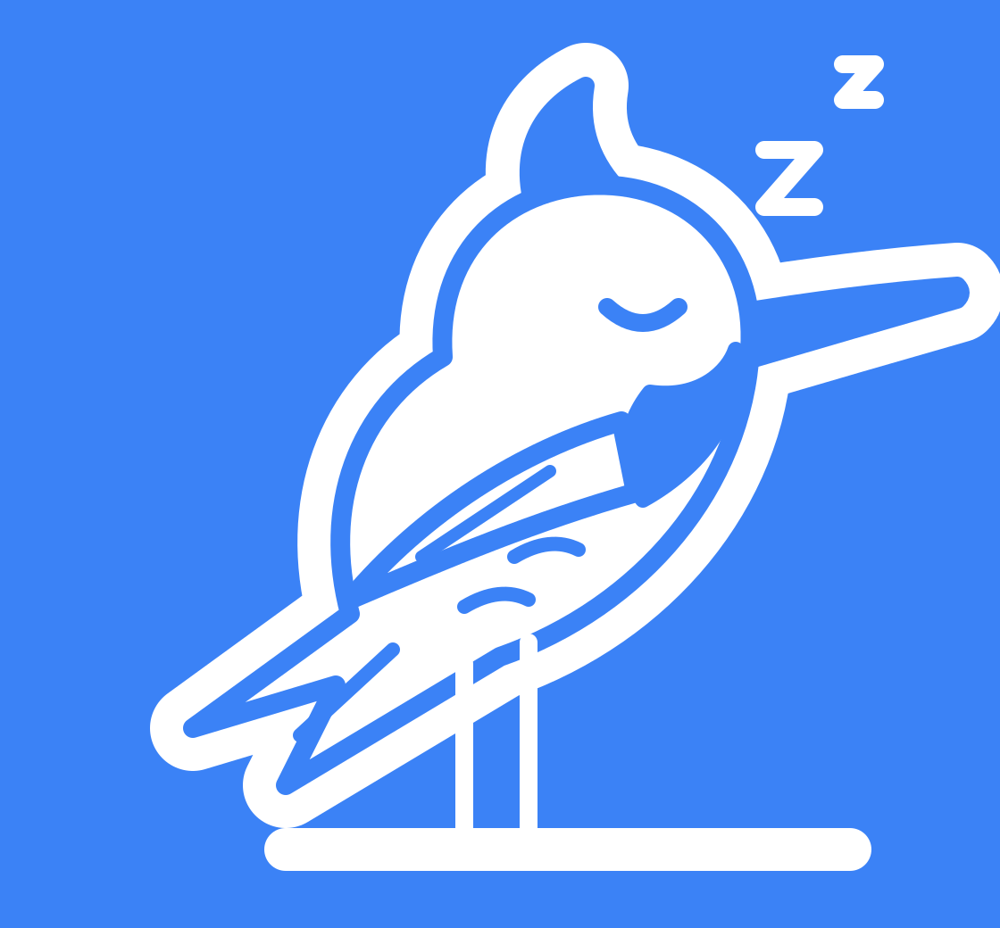
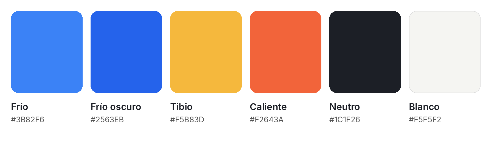

  

  <strong>Un navegador ligero para macOS y Windows, escrito en Rust, con su propio buscador.</strong>

  
  
  
  
  

---

## Qué es Blyni

Blyni es un navegador de escritorio que aprovecha el motor web del sistema (WebKit en macOS, WebView2 en Windows) y pone encima su propia capa, escrita en Rust: la gestión de pestañas, el bloqueo de contenido, la barra de direcciones y un buscador propio con su índice, su página de resultados y sus servicios de texto.

El objetivo es uno: **un navegador que gaste poco y que se pueda medir**. Cada decisión de diseño se apoya en un estudio previo y en cifras reproducibles, y lo que todavía no está verificado aparece marcado como «Prox» en la interfaz y en la documentación.

## Lo que lo hace distinto

| | |
|---|---|
| **Tres niveles de memoria** | Cada pestaña vive en uno de tres niveles: **caliente** (en uso), **tibia** (lista, fuera de pantalla) y **fría** (sin vista, solo su estado guardado). Un balanceador decide el nivel según el uso, el audio, las descargas, los formularios sin guardar y la presión de memoria del sistema. |
| **Bloqueo integrado** | Usa `adblock-rust`, el motor de Brave, con listas tipo EasyList. En macOS las listas se convierten a reglas nativas de WebKit y el motor no queda en memoria. |
| **Buscador propio** | Índice local, página de resultados propia, sugerencias en la barra, sitio oficial destacado y corrección ortográfica («Quizás quisiste decir»). Los servicios corren en el propio equipo. |
| **Respuestas con citas** | Un sintetizador extractivo arma una respuesta corta con oraciones tomadas tal cual de las fuentes, cada una con su cita. No redacta texto propio y no aparece cuando la evidencia no alcanza. |
| **Audio y lectura** | Silencio y volumen independientes por pestaña, modo lectura y lectura en voz alta con la voz del sistema. |
| **Diseño propio** | Interfaz nativa en cada sistema, con una sola familia de iconos (Lucide) y la paleta de la marca. |

## Arquitectura

Blyni está dividido en un núcleo y varias piezas independientes que se comunican mediante contratos gRPC versionados.

## Componentes

Los repositorios del proyecto son privados por ahora.

| Repositorio | Qué contiene |
|---|---|
| `blyni` | Núcleo: lógica común, la app, la pestaña nueva, los iconos, la documentación y los estudios técnicos. |
| `blyni-macos` | Capa de macOS sobre AppKit y `WKWebView`. |
| `blyni-windows` | Capa de Windows sobre Win32 y WebView2. |
| `blyni-bloqueo` | Servicio de bloqueo de contenido sobre `adblock-rust`. |
| `blyni-proto` | Contratos gRPC (`.proto`) entre todas las piezas. |
| `blyni-motor-busqueda` | Motor de búsqueda: índice, ranking, sugerencias, bangs y servidor. |
| `blyni-normalizador` | Normalización de texto: pliegue único, NFKC, transliteración y corrección ortográfica. |
| `blyni-sintetizador` | Sintetizador de respuestas extractivo y su servicio gRPC. |
| `blyni-websurfx` | Página de resultados, derivada de websurfx. |
| `blyni-stract` | Ranking derivado de Stract. |
| `blyni-marca` | Kit de marca: mascota, logotipos, iconos de la app, favicons y paleta. |

## Principios de ingeniería

- **Rust primero.** El núcleo, las capas de plataforma y los servicios están escritos en Rust.
- **Contratos explícitos.** Las piezas hablan por gRPC con contratos versionados; los cambios se agregan sin romper a quien ya los usa.
- **Estudiar antes de construir.** Cuando alguien ya resolvió un problema (navegadores, buscadores, bibliotecas abiertas), se estudia su solución, se mide contra la nuestra y se adapta con su licencia respetada.
- **Medir siempre.** Memoria, arranque, latencia y tamaño del binario se miden con un método documentado, antes y después de cada cambio relevante.
- **Pruebas en el sistema real.** Cada plataforma tiene una autoprueba que maneja la app con su motor web real; en Windows corre en integración continua.
- **Sin promesas sin verificar.** Lo que falta o no se ha comprobado se marca «Prox» y tiene su issue.

## Estado

- Versión `0.1.0`, en desarrollo activo. Todavía no hay versiones públicas para descargar.
- **macOS:** funcional y probado de punta a punta con WebKit real.
- **Windows:** compila para x64 y ARM64; las pruebas y la autoprueba corren en Windows real dentro de la integración continua.

## Marca

  
  
  
  

La mascota de Blyni es un **colibrí**: pequeño, rápido y eficiente con su energía, como quiere ser el navegador. Tiene cuatro poses (volando, guiñando, posado y dormido), y la pose dormida representa a la pestaña fría.

### Paleta

  

Los colores de la marca son también los de los niveles de memoria de las pestañas.

| Color | Hex | Uso |
|---|---|---|
| Caliente | `#F2643A` | Pestaña en uso; el punto del wordmark |
| Tibio | `#F5B83D` | Pestaña tibia, lista para volver |
| Frío | `#3B82F6` | Pestaña fría |
| Frío oscuro | `#2563EB` | Variante del frío sobre fondos claros |
| Neutro | `#1C1F26` | Texto y fondos oscuros |
| Blanco | `#F5F5F2` | Fondos claros |

### Tipografía e iconos

- **Wordmark:** Titan One.
- **Texto:** Inter.
- **Iconos de la interfaz:** [Lucide](https://lucide.dev), con trazo redondeado y sin relleno, en el color del texto. El color de marca se reserva para las temperaturas de las pestañas y el escudo del bloqueador.

## Licencias

- **Código:** GPL-3.0-or-later.
- **Piezas del buscador derivadas de websurfx y Stract:** conservan la licencia AGPL-3.0 de su origen, igual que los binarios que las enlazan.
- **Marca:** el nombre Blyni, la mascota, el wordmark, los logotipos y los iconos de la app son de su autor, con todos los derechos reservados. La licencia del código no se extiende a la marca: un fork puede conservar el código según su licencia, pero debe cambiar el nombre y los logotipos.
- **Tipografías:** Titan One e Inter, bajo la SIL Open Font License 1.1. **Iconos:** Lucide, bajo la licencia ISC.

---

  Blyni &middot; navegador ligero en Rust para macOS y Windows

